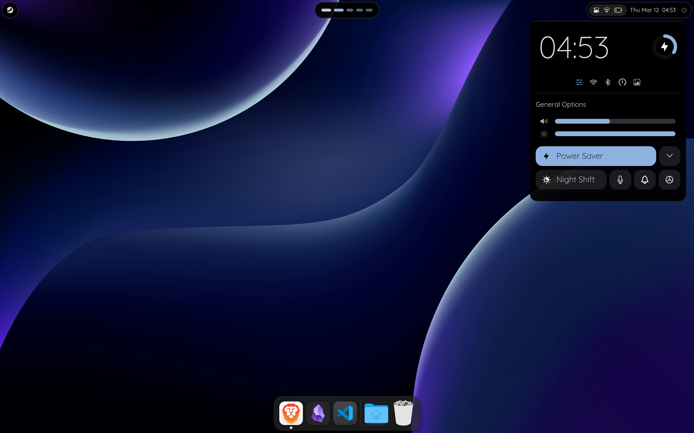

# Kiwi Shell

A macOS-style desktop shell for Hyprland.



- **Dock** with window previews, minimizing into it
- **Mission Control** and desktops, as macOS has them, with trackpad gestures
- **App switcher** with live window previews
- **Launcher** for apps, open windows, sums and the web
- **Menu bar** with the system menu, tray and notifications
- **Dynamic Island** in the bar: desktops, date or weather, and music, privacy dots and alerts as they happen
- **Accent colour** from the wallpaper, **Night Shift**, desktop icons
- **Kiwi Settings** for all of it

## Requirements

- Hyprland 0.56 or newer, with a Lua config
- NetworkManager, BlueZ, power-profiles-daemon and WirePlumber; UPower on laptops

## Install

### Arch Linux

```bash
sudo pacman -S networkmanager bluez power-profiles-daemon wireplumber upower
yay -S kiwi-shell

# the Hyprland plugin: live previews, the minimize animation, Mission Control
hyprpm add https://github.com/selimbucher/kiwi-shell
hyprpm enable kiwi
```

```lua
-- hyprland.lua
hl.on("hyprland.start", function()
  hl.exec_cmd("hyprpm reload -n")
end)
```

### NixOS

```nix
# flake.nix
inputs.kiwi-shell = {
  url = "github:selimbucher/kiwi-shell";
  inputs.nixpkgs.follows = "nixpkgs";
};
```

```nix
# home.nix (Home Manager); the plugin is built and loaded with it
{ inputs, ... }:
{
  imports = [ inputs.kiwi-shell.homeManagerModules.default ];
  services.kiwi-shell.enable = true;
}
```

Without Home Manager, apply `inputs.kiwi-shell.overlays.default` and install `pkgs.kiwi-shell`.

## Run

```bash
kiwi
```

## Update

```bash
yay -Syu && hyprpm update                                            # Arch
nix flake update kiwi-shell && sudo nixos-rebuild switch --flake .   # NixOS
```

Then log out and back in: Hyprland keeps the plugin it loaded.

## Shortcuts

| | Default |
|---|---|
| Launcher | Tap Super |
| App switcher | Alt+Tab |
| Mission Control | Ctrl+Super+Up, or three fingers up |
| Desktop on the left / right | Ctrl+Super+Left / Right, or three fingers sideways |
| Notifications | Four fingers left |
| Classic workspace switcher | None |

Change them in Kiwi Settings → Keybinds (+ adds another), or in Home Manager, like any other setting:

```nix
services.kiwi-shell.settings.shortcuts = {
  mission_control = "Ctrl+Up";
  workspace_switcher = "Super+Tab";   # held like Alt+Tab
  launcher = [ "Super" "Super+space" ];   # several for one action
};
```

Leave these keys out of your Hyprland config: Kiwi Shell takes them while it runs.

## Look

- Font: [Quicksand](https://aur.archlinux.org/packages/ttf-quicksand-variable)
- Icons: [WhiteSur](https://github.com/vinceliuice/WhiteSur-icon-theme), with Alternative Icons and Bold Panel Icons
